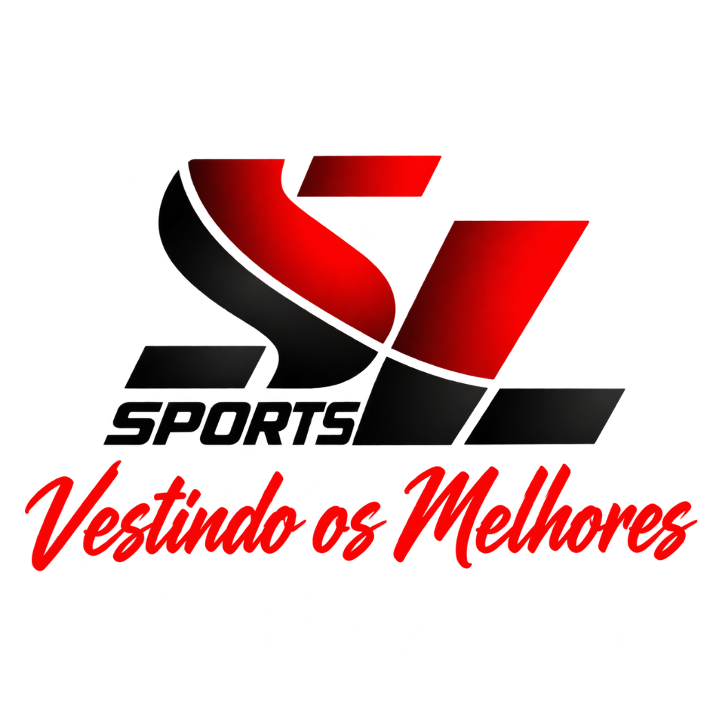

# 🏆 SL Sports - Vestindo os Melhores



Página de vendas / landing page da **SL Sports** — loja de uniformes personalizados localizada em Boituva-SP.

## 📋 Sobre

A SL Sports é especializada na confecção de uniformes esportivos personalizados, camisas de torcida, bandeiras e muito mais. Cada peça é produzida com sublimação de alta qualidade e materiais premium.

## 🚀 Estrutura do Projeto

```
slsports/
├── index.html                  # Página principal (landing page)
├── assets/
│   └── images/
│       └── logo-sl-sports.png  # Logo vetorizada da SL Sports
└── README.md
```

## 🎨 Seções da Página

- **Hero** — Apresentação impactante com CTA para WhatsApp
- **Estatísticas** — Números da empresa (projetos, clientes, experiência)
- **Serviços** — Camisas de time, uniformes esportivos, corporativos, bandeiras, criação de arte, camisas de evento
- **Diferenciais** — Sublimação premium, atendimento personalizado, tecido de qualidade, entrega nacional
- **Como Funciona** — Processo em 4 etapas simples
- **Depoimentos** — Avaliações de clientes
- **Contato** — CTA final com WhatsApp, localização e Instagram

## 📱 Contato

- **WhatsApp**: [(15) 99718-1733](https://wa.me/5515997181733)
- **Instagram**: [@sl.sports](https://www.instagram.com/sl.sports/)
- **Localização**: Boituva - SP

## 🛠️ Tecnologias

- HTML5
- CSS3 (animações, gradientes, responsividade)
- JavaScript (contadores animados, scroll effects)

## 📦 Como usar

1. Clone o repositório:
   ```bash
   git clone https://github.com/Filipe-Machado0/slsports.git
   ```
2. Abra o arquivo `index.html` no navegador

---

**© 2026 SL Sports. Todos os direitos reservados.**
